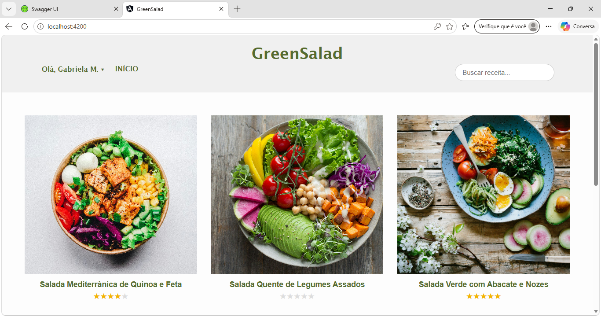
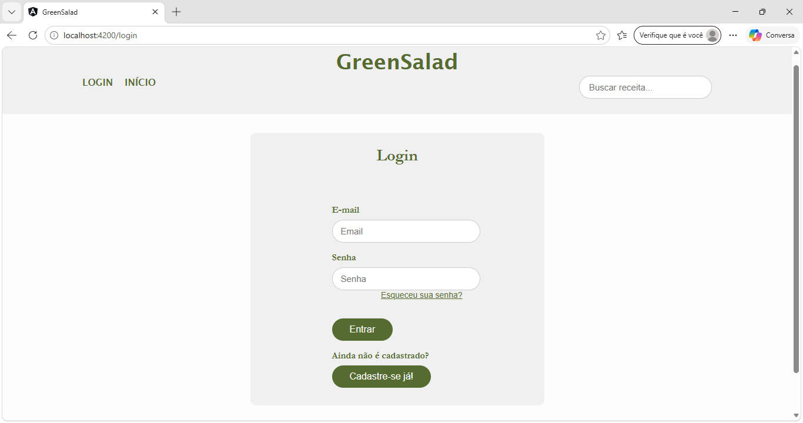
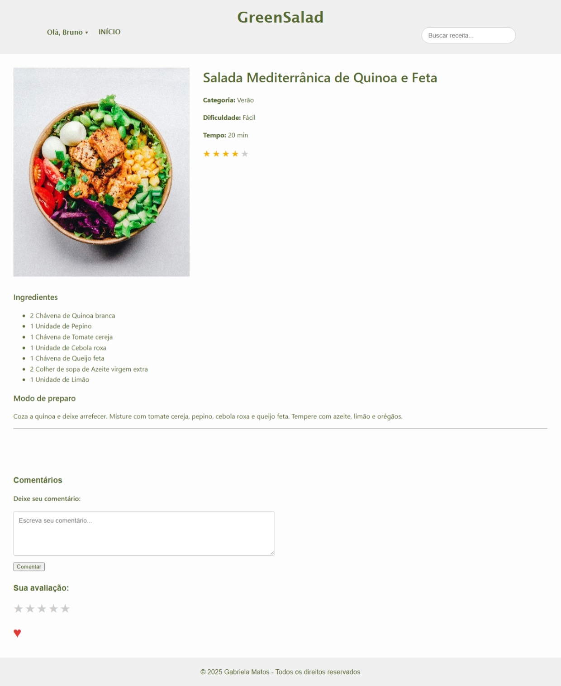
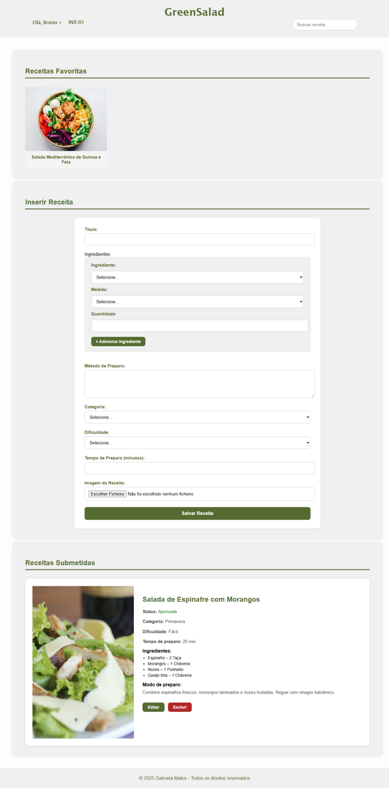
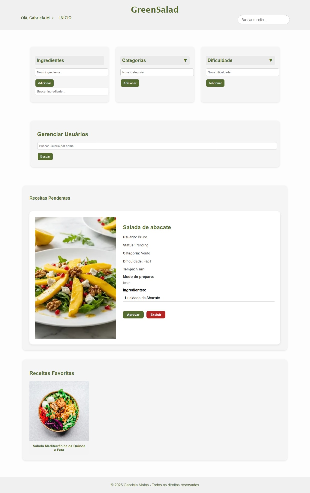

# Recipe Site (GreenSalad)

A full-stack recipe-sharing web application. Anyone can sign up, submit their own recipes and discover recipes from other users. Every submitted recipe is reviewed by an administrator, who decides whether it gets published.

> Final project of the Junior Developer Academy at Assembly.



---

## Features

### Visitors
- Browse published recipes and search them by name
- Create an account and log in (JWT authentication)

### Registered users
- Submit new recipes with an image: title, ingredients (ingredient + unit of measure + quantity), preparation method, category, difficulty and preparation time
- Recipes are published only after admin approval; users can follow the status of each submission (pending / approved)
- Edit and delete their own recipes
- View recipes from other users
- Comment on recipes
- Rate recipes (1–5 stars); the average rating is shown on the recipe cards
- Save recipes as favourites and see them on their personal page

### Administrators
- Review pending recipes: **approve** or **delete** them
- Manage the catalogue of **ingredients, categories and difficulty levels**
- Search and manage **users**

---

## Tech Stack

| Layer | Technology |
|-------|------------|
| Front-end | Angular 16, TypeScript, HTML5, CSS3 |
| Back-end | C# · .NET 8 · ASP.NET Core Web API |
| Database | SQL Server |
| ORM | Entity Framework Core 8 |
| Authentication | JWT (JSON Web Tokens) |
| API documentation | Swagger UI (Swashbuckle) |

### Architecture
The back-end follows a layered structure: **Controllers → Services → Repositories → Database (EF Core)**, with dependency injection throughout.

---

## Project Structure

```
RecipeSite/
├── database/
│   └── RecipeSite.sql   # Database script (schema + sample data)
├── backend/
│   ├── API/          # Controllers, JWT & Swagger setup, image uploads
│   ├── Services/     # Business logic
│   ├── Repository/   # EF Core DbContext and data access
│   ├── Models/       # Entities
│   └── MasterChiefRecipe.sln
└── frontend/         # Angular application
    └── src/app/      # admin, logged, login, signin, recipe-details, home, services, models...
```

---

## Getting Started

The project is not deployed, so it runs locally.

### Prerequisites
- [.NET 8 SDK](https://dotnet.microsoft.com/download)
- Node.js 18+ and Angular CLI 16 (`npm install -g @angular/cli@16`)
- SQL Server (Express is enough) and SQL Server Management Studio (or Azure Data Studio)

### 1. Clone the repository

```bash
git clone https://github.com/MatosFG/RecipeSite.git
cd RecipeSite
```

### 2. Set up the database
Run the script `database/RecipeSite.sql`. It creates the `RecipeSite` database, all tables and sample data: categories, difficulty levels, measurement units, ingredients, a few approved recipes with comments, ratings and favourites, and test accounts.

- In SQL Server Management Studio: open `database/RecipeSite.sql` and click **Execute**, or
- From the command line:
  ```bash
  sqlcmd -S localhost\SQLEXPRESS -E -f 65001 -i database/RecipeSite.sql
  ```

The connection string in `backend/API/appsettings.json` points to a local SQL Server Express instance (`localhost\SQLEXPRESS`) using Windows authentication. Adjust it if your setup is different.

### 3. Run the API

```bash
cd backend/API
dotnet run
```

The API starts at `http://localhost:5233` (or `https://localhost:7048`) and the Swagger UI opens at `/swagger`.

### 4. Run the front-end

```bash
cd frontend
npm install
ng serve
```

Open `http://localhost:4200`.

### Test accounts
- **Admin:** admin@recipesite.com / 123456
- **User:** user@recipesite.com / 123456

> **Note:** the `Jwt:Key` in `appsettings.json` is a sample value for local use only. Replace it with your own secret (at least 32 characters) if you deploy this project.

---

## Screenshots

### Home and login
| Home | Login |
|------|-------|
|  |  |

### Recipe page: ingredients, comments, rating and favourites


### User area: favourites, new recipe form and submitted recipes


### Admin panel: catalogue management, user management and pending recipes


---

## What I Learned

- Building a full-stack application: an Angular front-end consuming a C# REST API
- Layered architecture with dependency injection (controllers, services, repositories)
- Modelling a relational database with Entity Framework Core and SQL Server
- Authentication and role-based access (user vs. admin) with JWT
- Handling file uploads (recipe images)

## Future Improvements

- Filters by category, difficulty and preparation time
- Moving secrets (JWT key) to environment variables or user secrets
- Restricting CORS to the front-end origin
- Deploying the app online

---

## Author

**Gabriela Matos**
[LinkedIn](https://www.linkedin.com/in/gabriela-f-matos) · [GitHub](https://github.com/MatosFG)
